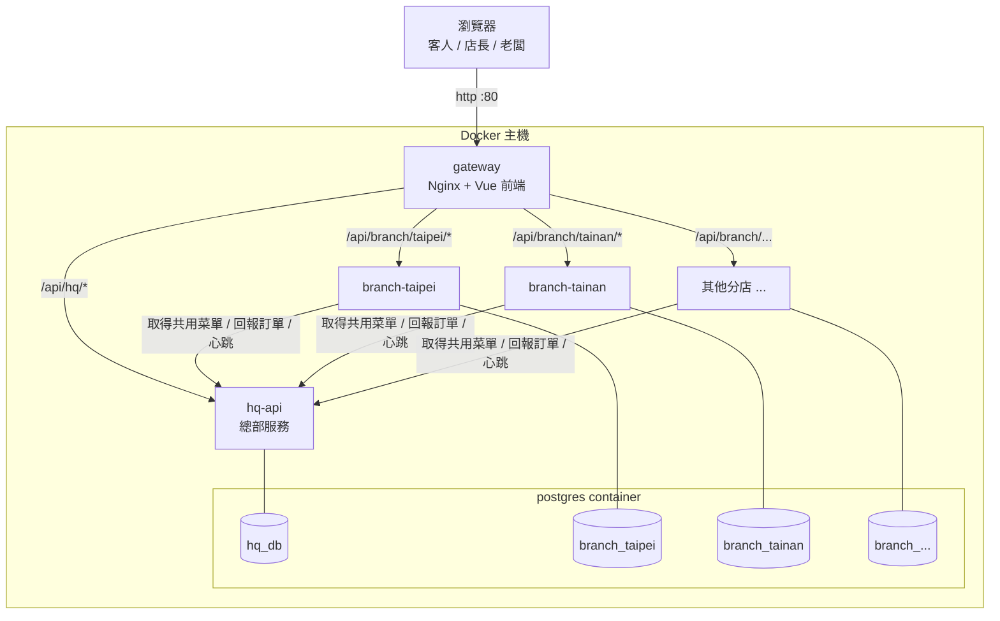

# 開心茶飲 Happy Tea — 系統手冊

> 快速部署請看 [README](README.md)。這份手冊包含架構說明、使用說明、新增分店與維運指令。

一套讓連鎖飲料店**所有分店共用、但各自獨立運作**的系統：

- 所有分店使用**一致的網站版面與操作介面**，並供應**相同的經典菜單**（由總部統一管理）
- 每間分店有**自己的網址、自己的服務與資料庫**，店長可以研發並上架**本店特色飲品**（自訂品名、價格、說明，並上傳照片）
- 各分店的訂單會自動回報總部：**老闆看得到全品牌營收**，**店長看得到自己分店的經營資訊**
- 有 Kiosk 的門市可以開啟**自助點餐機模式**，讓客人在店內自己點餐
- 新增分店（加盟店）**只需一行指令**，不必修改任何程式

---

## 目錄

1. [系統架構](#1-系統架構)
2. [部署方式（在 Ubuntu 上從零開始）](#2-部署方式在-ubuntu-上從零開始)
3. [新增分店／加盟店](#3-新增分店加盟店)
4. [使用說明（客人、店長、老闆）](#4-使用說明)
5. [常用維運指令](#5-常用維運指令)
6. [專案結構與 API](#6-專案結構與-api)
7. [AI 輔助開發說明](#7-ai-輔助開發說明)

---

## 1. 系統架構



| 元件 | 說明 |
|---|---|
| **gateway**（Nginx + Vue 3） | 唯一對外開放的入口（port 80）。提供前端網頁，並依網址把 API 轉發到總部或對應分店。分店是用 Docker DNS 動態解析的，所以新增分店時 **不用改 Nginx 設定** |
| **hq-api**（Node.js / Express） | 總部服務：管理共用菜單、分店註冊、帳號登入（JWT）、彙總全品牌營收 |
| **branch-xxx**（Node.js / Express） | 分店服務：**每間分店跑同一個 image**，用環境變數 `BRANCH_CODE` 區分。負責本店菜單、特色飲品（含照片）、訂單、本店營收統計 |

### 菜單的兩個層級

| | 經典飲品（5 款） | 本店特色飲品 |
|---|---|---|
| 誰管理 | 總部老闆 | 各分店店長 |
| 出現在哪 | **所有分店**都相同，維持品牌一致性 | **只有該分店**，做出差異化 |
| 資料存在 | `hq_db`（分店會在本地快取一份） | 該分店自己的 `branch_xxx` 資料庫 |
| 可以做什麼 | 改名稱、價格、說明，上下架 | 自訂品名、價格、說明，**上傳照片**，上下架、刪除 |
| **postgres**（PostgreSQL 16 alpine） | 一個 container 裡為總部與每間分店各建一個**獨立資料庫**，資料彼此隔離。這是為了節省 VM 資源；正式環境中可以把各分店資料庫搬到不同主機 |

### 分散式設計重點

- **資料各自擁有**：分店的特色飲品與訂單存在自己的資料庫，總部只收到訂單的彙總副本
- **總部掛了，分店照常營業**：分店會在本地快取總部的共用菜單；總部離線時訂單照樣成立並標記為「待同步」，總部恢復後每 10 秒自動補送
- **重送不會重複計算**：總部以 `(分店代碼, 分店訂單編號)` 去重，所以同步可以安全重試
- **自動註冊與心跳**：分店啟動時會自動向總部註冊（並自動建立店長帳號），之後每 30 秒回報一次心跳，總部後台據此顯示分店在線或離線
- **權限**：帳號統一由總部發放 JWT。`admin`（老闆）可以看所有分店；`manager`（店長）只能管理自己的分店，分店服務會自行驗證

---

## 2. 部署方式（在 Ubuntu 上從零開始）

> 以下步驟在 **Ubuntu 22.04 / 24.04**（含 VMware 虛擬機）測試。建議 VM 至少 **2 GB RAM、2 CPU、10 GB 硬碟**。
> **不需要**另外安裝 Node.js 或資料庫，全部都在 Docker 裡面跑。

### Step 1：安裝 Docker 與 Git

```bash
# Add Docker's official GPG key:
sudo apt-get update
sudo apt-get install -y ca-certificates curl
sudo install -m 0755 -d /etc/apt/keyrings
sudo curl -fsSL https://download.docker.com/linux/ubuntu/gpg -o /etc/apt/keyrings/docker.asc
sudo chmod a+r /etc/apt/keyrings/docker.asc

# Add the repository to Apt sources:
echo \
  "deb [arch=$(dpkg --print-architecture) signed-by=/etc/apt/keyrings/docker.asc] https://download.docker.com/linux/ubuntu \
  $(. /etc/os-release && echo "$VERSION_CODENAME") stable" | \
  sudo tee /etc/apt/sources.list.d/docker.list > /dev/null
sudo apt-get update

sudo apt-get install -y docker-ce docker-ce-cli containerd.io docker-buildx-plugin docker-compose-plugin

# Install SSH & Git
sudo apt install openssh-server git -y
```

讓目前的使用者不用 `sudo` 也能執行 docker（執行後請**登出再登入**，或直接重開機）：

```bash
sudo usermod -aG docker $USER
```

確認安裝成功：

```bash
docker --version
docker compose version
```

> 如果不想登出，也可以在之後所有 `docker` 指令前面加上 `sudo`。

### Step 2：下載專案

```bash
git clone https://github.com/jennifer-yc-cheng/M11407007_MIDTERM.git
cd M11407007_MIDTERM
```

### Step 3：（建議）設定密碼與金鑰

```bash
cp .env.example .env
nano .env        # 修改 JWT_SECRET、INTERNAL_TOKEN、各種密碼
```

> 沒有 `.env` 也可以直接啟動，系統會使用預設值（只適合測試）。

### Step 4：啟動整個系統

```bash
docker compose up -d --build
```

第一次執行會下載 image 並編譯前端，大約需要 3～5 分鐘。完成後確認狀態：

```bash
docker compose ps
```

應該看到 `postgres`、`hq-api`、`gateway` 與 6 個 `branch-*` 都是 `running`。

### Step 5：開啟網站

- 在 Ubuntu 裡：開瀏覽器到 <http://localhost>
- 從 Windows 主機（或同網段的其他電腦）：先在 Ubuntu 查 IP

  ```bash
  ip -4 addr | grep inet      # 找到類似 192.168.x.x 的位址
  ```

  再用瀏覽器開 `http://<Ubuntu 的 IP>`

> VMware 網路使用 NAT 或 Bridged 都可以。如果有開防火牆，請放行 80 port：`sudo ufw allow 80/tcp`

### Step 6：（選用）產生示範訂單

```bash
bash scripts/demo-orders.sh 10
```

這會替每間分店產生 10 筆隨機訂單，方便展示總部與分店的營收畫面。

### 預設帳號

| 角色 | 帳號 | 密碼 | 可以做什麼 |
|---|---|---|---|
| 總部老闆 | `admin` | `admin123` | 看全部分店營收、管理共用菜單、進入任何分店後台 |
| 分店店長 | `<分店代碼>-manager`，例如 `taipei-manager` | `manager123` | 管理自己分店的特色飲品、看自己分店的營收與訂單 |

預設的 6 間分店：

| 代碼 | 分店 | 城市 |
|---|---|---|
| `taoyuan` | 桃園中正店 | 桃園市 |
| `zhongli` | 中壢中央店 | 桃園市 |
| `bade` | 八德介壽店 | 桃園市 |
| `taipei` | 台北信義店 | 台北市 |
| `taichung` | 台中逢甲店 | 台中市 |
| `tainan` | 台南成大店 | 台南市 |

---

## 3. 新增分店／加盟店

開新分店或有人加盟時，**不需要改任何程式碼**，在主機上執行一行指令即可：

```bash
bash scripts/add-branch.sh <分店代碼> <分店名稱> <城市> [地址]

# 範例
bash scripts/add-branch.sh kaohsiung 高雄巨蛋店 高雄市 "高雄市左營區博愛二路 777 號"
```

這個 script 會自動完成以下事情：

1. 把新分店寫進 `docker-compose.override.yml`（Docker Compose 會自動讀取這個檔案）
2. 用同一個 `branch-api` image 啟動 `branch-kaohsiung` container
3. 分店服務啟動時自動建立 `branch_kaohsiung` 資料庫
4. 自動向總部註冊，總部同時建立店長帳號 `kaohsiung-manager`

完成後：

- 點餐頁：`http://<主機IP>/kaohsiung`
- 店長後台：`http://<主機IP>/kaohsiung/admin`（帳號 `kaohsiung-manager`）

> 分店代碼只能使用小寫英文、數字與 `-`，且不能使用系統保留字 `hq`、`login`、`api`、`assets`、`drinks`。

---

## 4. 使用說明

分店**不需要安裝或下載任何東西**，用瀏覽器打開網址就能使用。

### 客人（點餐）

1. 打開首頁 `http://<主機IP>/`，選擇分店
2. 分店頁面會列出**本店特色飲品**與**經典飲品**
3. 選擇甜度、冰塊後按「加入」，確認購物車後按「送出訂單」

### 店內自助點餐機（Kiosk）

有觸控螢幕或平板的門市，可以讓客人自己點餐：

1. 在店內的平板／觸控螢幕上，用瀏覽器開啟 `http://<主機IP>/<分店代碼>/kiosk`（例如 `/taipei/kiosk`），按右下角「全螢幕」
   - 也可以從店長後台按「開啟 Kiosk 點餐機」
2. 客人點一下畫面開始 → 點選飲品 → 選甜度、冰塊、數量 → 加入購物車 → 確認送出
3. 畫面會顯示**取餐號碼**，客人到櫃台付款取餐；約 12 秒後自動回到歡迎畫面
4. 如果客人點到一半離開，**閒置 60 秒**後會自動清空購物車，回到歡迎畫面
5. Kiosk 的訂單會標示來源為「Kiosk」，店長後台可以看到今日有多少筆是自助點餐

> Kiosk 不需要登入，跟網站點餐一樣是公開的點餐頁面，只是改用大按鈕的觸控版面。
> 若要讓平板開機就進入 Kiosk，可以用 Chrome 的 `--kiosk` 參數開啟上述網址。

### 分店店長

1. 按右上角「管理登入」，用店長帳號（例如 `taipei-manager`）登入
2. 系統會自動進入自己分店的後台 `/<分店代碼>/admin`，可以：
   - 查看**今日營收、今日訂單、累計營收**、近 7 日營收圖、熱銷品項
   - **研發並上架本店特色飲品**：按「＋ 新增特色飲品」，輸入品名、價格、說明，並選擇一張照片（手機拍的照片也可以，系統會自動壓縮）
   - 編輯、上下架、刪除特色飲品，或在照片欄按「更換／移除」管理照片
   - 特色飲品只會出現在本店的網站與 Kiosk 菜單
   - 查看最近訂單（含訂單來源：網站或 Kiosk），以及每筆訂單是否已同步到總部
   - 按「開啟 Kiosk 點餐機」開啟本店自助點餐畫面
3. 店長**只能**進入自己分店的後台

### 總部老闆

1. 用 `admin` 登入後會進入總部後台 `/hq`，可以：
   - 查看**全品牌**今日／累計營收，以及**每間分店**的營收、訂單數、在線狀態
   - 查看各分店營收比較、全品牌近 7 日營收、全品牌熱銷品項
   - **管理經典飲品（共用菜單）**：修改價格、新增或下架品項，所有分店會立即套用
   - 依分店篩選最新訂單
   - 點選任一分店，進入該分店的菜單或後台

---

## 5. 常用維運指令

```bash
docker compose ps                         # 查看所有服務狀態
docker compose logs -f hq-api             # 查看總部服務 log
docker compose logs -f branch-taipei      # 查看某分店 log
docker compose restart branch-taipei      # 重啟某分店
docker compose stop hq-api                # 模擬總部故障（分店仍可點餐，訂單會待同步）
docker compose start hq-api               # 總部恢復後，待同步訂單會自動補送
docker compose down                       # 停止系統（保留資料）
docker compose down -v                    # 停止並刪除所有資料（重新開始）
git pull && docker compose up -d --build  # 更新程式後重新部署
```

進入資料庫查看：

```bash
docker compose exec postgres psql -U drink -l                    # 列出所有資料庫
docker compose exec postgres psql -U drink -d hq_db              # 進入總部資料庫
docker compose exec postgres psql -U drink -d branch_taipei      # 進入台北店資料庫
```

### 發布 image 到 Docker Hub

`docker-compose.yml` 裡的 image 名稱已經是 Docker Hub 的格式（`yearafter/drinkchain-xxx:1.0`），所以 build 完就能直接推送：

```bash
sudo docker login                  # 輸入 Docker Hub 帳號 yearafter 與密碼（或 Access Token）
sudo docker compose build          # 編譯 hq-api、branch-api、gateway 三個 image
sudo docker compose push           # 推送到 Docker Hub（postgres 是官方 image，不會推送）
```

| Docker Hub repository | 內容 |
|---|---|
| `yearafter/drinkchain-hq-api` | 總部服務 |
| `yearafter/drinkchain-branch-api` | 分店服務（所有分店共用） |
| `yearafter/drinkchain-gateway` | 前端網站 + Nginx gateway |

其他主機部署時可以直接下載這些 image，不必在本機編譯：`sudo docker compose pull && sudo docker compose up -d`

---

## 6. 專案結構與 API

```
.
├── docker-compose.yml        # 所有服務定義（含 6 間預設分店）
├── .env.example              # 環境變數範本
├── scripts/
│   ├── add-branch.sh         # 新增分店
│   └── demo-orders.sh        # 產生示範訂單
├── hq-api/                   # 總部服務（Node.js + Express + PostgreSQL）
├── branch-api/               # 分店服務（所有分店共用同一份程式）
└── frontend/                 # Vue 3 前端 + Nginx gateway 設定
    └── public/drinks/        # 經典飲品圖片
```

### 總部 API（對外路徑 `/api/hq/...`）

| Method | Path | 權限 | 說明 |
|---|---|---|---|
| POST | `/auth/login` | 公開 | 登入，取得 JWT |
| GET | `/branches` | 公開 | 分店列表與在線狀態 |
| GET | `/menu` | 公開 | 共用菜單 |
| GET/POST/PUT | `/admin/menu[/:id]` | admin | 管理共用菜單 |
| GET | `/admin/stats` | admin | 全品牌與各分店營收統計 |
| GET | `/admin/sales` | admin | 已同步的訂單 |
| POST | `/internal/branches/register` | 內部 token | 分店註冊／心跳（Gateway 不對外開放） |
| POST | `/internal/sales` | 內部 token | 分店回報訂單（Gateway 不對外開放） |

### 分店 API（對外路徑 `/api/branch/<分店代碼>/...`）

| Method | Path | 權限 | 說明 |
|---|---|---|---|
| GET | `/menu` | 公開 | 共用菜單 + 本店特色飲品 |
| POST | `/orders` | 公開 | 下單（價格以伺服器端菜單為準；`channel` 為 `web` 或 `kiosk`） |
| GET/POST/PUT/DELETE | `/admin/specials[/:id]` | 該店店長或 admin | 管理特色飲品 |
| PUT/DELETE | `/admin/specials/:id/image` | 該店店長或 admin | 上傳（body 為 JPG/PNG/WebP，上限 2MB）或移除照片 |
| GET | `/specials/:id/image` | 公開 | 特色飲品照片 |
| GET | `/admin/orders` | 該店店長或 admin | 本店訂單 |
| GET | `/admin/stats` | 該店店長或 admin | 本店營收統計 |

### 本機開發（選用）

```bash
docker compose up -d          # 先把後端跑起來
cd frontend && npm install && npm run dev   # Vite dev server，/api 會轉給 http://localhost
```

---

## 7. AI 輔助開發說明

本專案使用 Claude Code（AI 程式助理）協助進行：

- 依需求討論架構：總部／分店服務拆分、資料庫隔離策略，以及輕量化考量（以單一 PostgreSQL 取代多個 MSSQL）
- 產生後端 API、資料表 schema、Vue 前端頁面、Docker／Nginx 設定與部署文件
- 設計分散式容錯機制：菜單快取、訂單離線待同步、冪等重送、心跳
